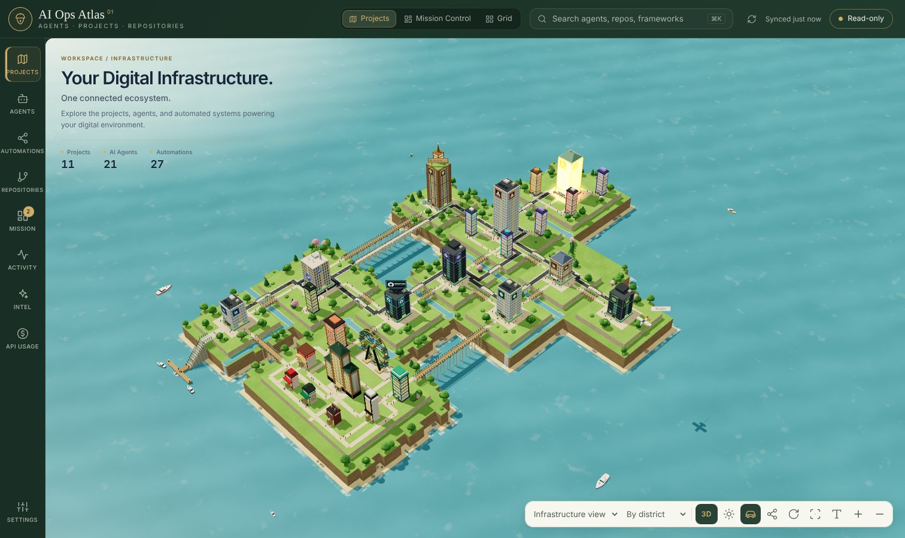
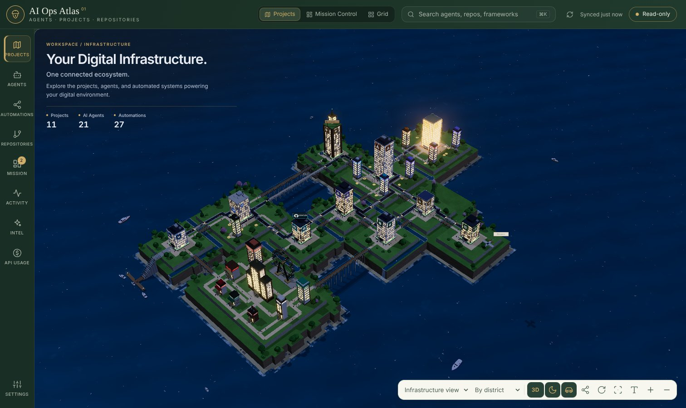
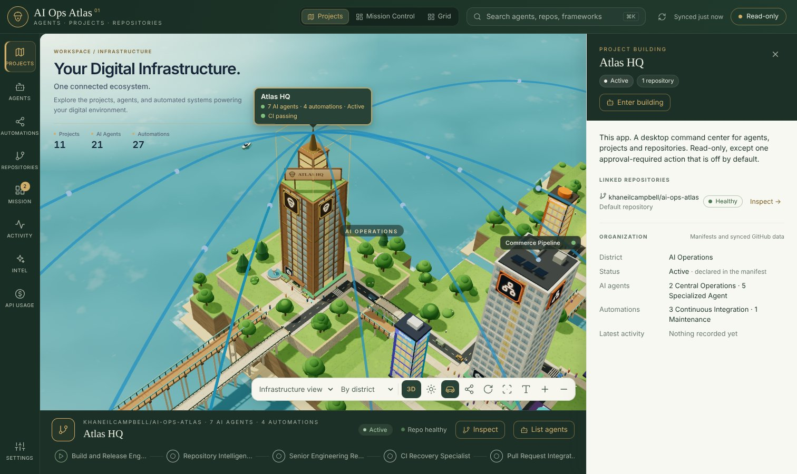
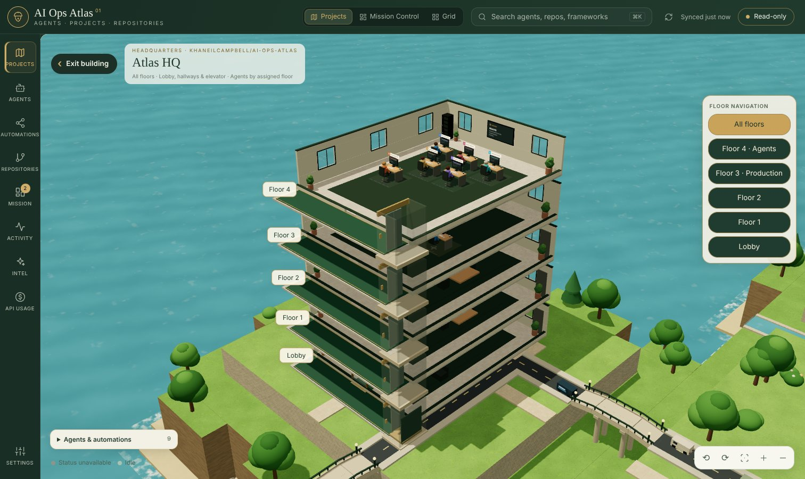
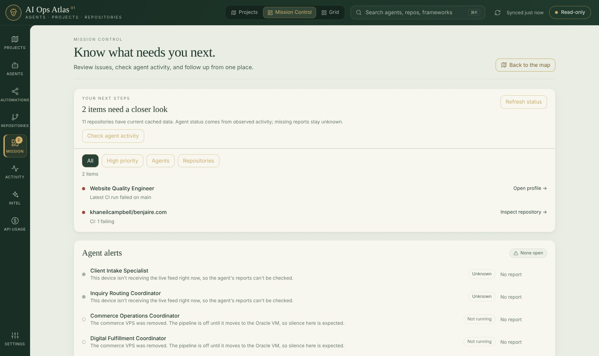
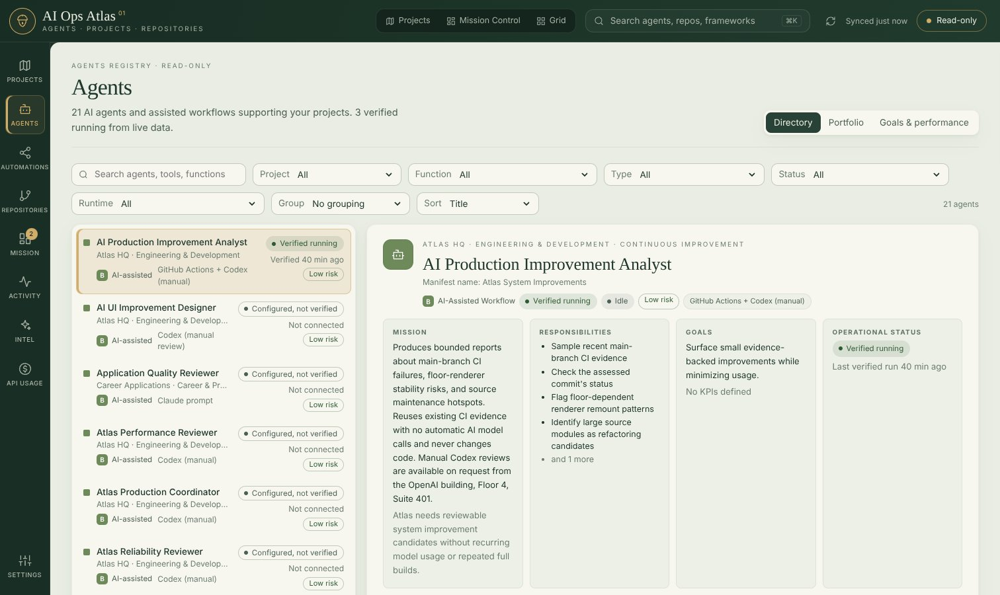
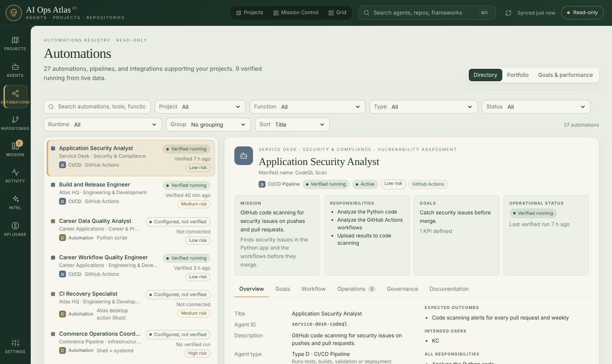
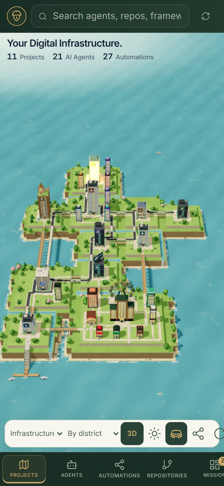

# AI Ops Atlas

A personal command center for AI agents, automations, projects and GitHub repositories, built as a macOS desktop app (Tauri, React, Rust) with a private web and iPhone version.

Atlas draws everything as a 3D city. Each project is a building in its own district, agents work at desks on the building's floors, and roads, bridges and connection lines show how the systems link up. Status comes from real data, such as GitHub runs, live webhooks and agent reports. Anything Atlas can't confirm is shown as unknown or "configured, not verified", never as healthy.

Today the city holds 11 projects, 21 AI agents and 27 automations.



## Screenshots

| | |
|---|---|
|  **Night mode.** Lit windows, street lights and traffic. |  **Selecting a building** shows its linked repository, district, agents and connections. |
|  **Inside a building.** Floor-by-floor cutaway with each agent at its assigned desk. |  **Mission Control.** What needs attention next, plus agent alerts. |
|  **Agents.** Every AI agent with its mission, goals, risk and verified status. |  **Automations.** CI pipelines, scripts and integrations, in the same format. |

<p align="center"><br><em>The same app on iPhone, behind Cloudflare Access.</em></p>

Screenshots use sample GitHub data from the visual test fixtures.

## Read-only by design

Atlas reads project manifests, GitHub data and agent reports. Its own Claude agents only read repositories and write reports. There are two exceptions, both in the Mac app only: **Re-run failed jobs** on a failed GitHub Actions run, and **Merge pull request** on a pull request GitHub reports ready (every required check green, no changes requested, not a draft). Each is off by default and limited to repositories you tick. Each needs approval in a macOS dialog every time (merges also need Touch ID), uses its own write-scoped token and is audited. See [docs/actions.md](docs/actions.md). Nothing else in the app can change a repository or start an external agent.

## What it does

| Area | What you see |
|---|---|
| Projects (map) | The 3D city. One building per project, grouped into districts (AI Operations, Business Operations, AI Engineering, Security & Infrastructure, Career & Portfolio), plus the Skyline district with the Anthropic, OpenAI and GitHub buildings for shared tools. Day and night lighting, traffic, connection lines between systems, and a 2D view. Select a building to inspect it, or enter it to walk its floors. See [docs/organization.md](docs/organization.md) |
| Mission Control | A filterable list of what needs you next (failed CI, agents needing review), the agent alerts list and the active agents. One click from the map |
| Agents and Automations | The registry. **Directory**: every item classified (AI agent, AI-assisted workflow, automation, CI/CD, integration, planned) with function, project, operational status, last verified run and risk. A six-tab inspector (Overview, Goals, Workflow, Operations, Governance, Documentation). **Portfolio**: counts by type, configured versus verified, and gaps. **Goals & performance**: KPI targets against observed values. See [docs/agent-registry.md](docs/agent-registry.md) |
| Repositories | Description, language, latest commit, CI, last push, open issues and PRs, license and linked agents for every repository |
| Activity | Recent commits, workflow runs and agent history across all projects |
| Intel | Claude-powered, read-only analysis. **Repository intelligence** assesses one repository ([docs](docs/repository-intelligence.md)). **Engineering review** scores the whole ecosystem ([docs](docs/engineering-review.md)). **GitHub Steward** checks Atlas's own repository health ([docs](docs/github-steward.md)). Also covers runs, traces and costs |
| API Usage | Token use and cost from real records only, with estimated and billed amounts kept apart. See [docs/api-usage.md](docs/api-usage.md) |
| Live updates | Workflow runs, pushes and agent runs appear as they happen, from GitHub App webhooks and agent reports collected by the site. See [docs/live-updates.md](docs/live-updates.md) and [docs/production-observability.md](docs/production-observability.md) |
| Agent alerts | Unattended customer-facing agents raise an alert when they report a failure or go silent: a red header pill, Mission Control's list, optional notifications and optional email. Agents that are off on purpose show as Not running. See [docs/alerts.md](docs/alerts.md) |
| Search | `⌘K` searches agents, repositories and frameworks from anywhere |
| Settings | Refresh interval, map options, GitHub token, Anthropic key, budgets and schedules, and the approval-required actions. Keys live in the macOS Keychain behind Touch ID |
| iPhone and web | The same app as a private Cloudflare Pages site behind Cloudflare Access, GET-only. See [docs/iphone.md](docs/iphone.md) |

## Run it

Requirements: Node 20+, Rust stable, and Xcode Command Line Tools on macOS.

```bash
npm install
npm run tauri dev        # desktop app with hot reload
npm run tauri build      # builds AI Ops Atlas.app and a .dmg under src-tauri/target/release/bundle
npm run dev              # browser-only preview at http://localhost:1420 (public GitHub data, no Keychain)
npm test                 # validates the catalog and the health/attention rules
```

## Install and update

Download `AI-Ops-Atlas-macOS.zip` from the [latest release](https://github.com/khaneilcampbell/ai-ops-atlas/releases/latest), unzip it and move **AI Ops Atlas** into Applications. The app isn't signed by Apple, so open it the first time with right-click → Open.

After that, Atlas updates itself. Every merge to `main` builds, signs and publishes a new version to the rolling `main-build` release. The app checks every 10 minutes and whenever its window comes into focus, then shows **Update available** in the header. Your token, settings and current view are kept. See [docs/ci-signing-security.md](docs/ci-signing-security.md).

To publish a numbered release, run `npm run version:set -- 0.3.0`, merge that change, then tag `v0.3.0` on `main` and push the tag. The Release workflow builds a universal (Apple silicon and Intel) app and attaches it.

## Contributing

`main` only takes pull requests that pass CI. Before pushing, run `npm run lint`, `npm test`, and in `src-tauri/`, `cargo fmt` and `cargo clippy --all-targets -- -D warnings`. Changes to the map, office or Mission Control are checked against screenshots with `npm run visual` (see [docs/visual-testing.md](docs/visual-testing.md)). Dependabot opens weekly update PRs, and CodeQL scans every PR. See [SECURITY.md](SECURITY.md) for how secrets are handled.

## Add a project or agent

Add or edit a YAML file in [`catalog/`](catalog/README.md). The format is documented there, and `npm test` fails on a broken manifest. There is one manifest for each of the 11 `khaneilcampbell` repositories, and a runbook for each project in [docs/runbooks](docs/runbooks). They include:

- **Multi-Agent Commerce Pipeline**: the autonomous loop, the six CrewAI brand-crew agents, and the Canva, Shopify, SEO and health-report stages
- **AI-Assisted SOC Brute Force Detection Lab**: the Splunk detection search and the SOC case-note automation
- **khaneilcampbell.com**: the Claude site assistant, the site audit script and the security-check workflow
- **Benjaire.com**: the contact form Worker, the Benjaire Flow intake in n8n and Site CI
- **AI Career Application Optimization System**: the three Claude prompt stages and the career database validator
- **AI Ops Atlas**: Atlas's own agents, including Repository Intelligence, the Senior Engineering Reviewer, GitHub Steward and the improvement analysts
- **GitHub Profile**: Merge Flow and Opportunity Scout, which work from the GitHub building in Skyline

Repositories with no manifest still appear. The app lists every repository owned by the accounts in **Settings → Show every repository owned by** (default `khaneilcampbell`), and shows the rest under "Not in the catalog yet" on the list and the map. Private repositories need a token.

Statuses and last-run times in the manifests are a starting point. Correct them by hand until live sources arrive.

## GitHub access and secrets

- All GitHub calls are `GET` requests to `api.github.com/repos/...`, plus the repository lists at `/users/{owner}/repos` and `/user/repos`. The Rust side rejects any other path.
- The app keeps GitHub usage low:
  - Repository details come from the one repository list used to find new repositories, instead of one request per repository.
  - Commits and languages are fetched again only when a repository's last push changes. Workflow runs are checked on each refresh with a token, or every 3 hours without one, and always while a run is still in progress.
  - One run list per repository covers both CI and the workflows agents observe.
  - Requests are conditional (ETags). With a token, GitHub doesn't count unchanged 304 answers against the limit; without one, every request counts.
  - Repositories checked within the refresh interval are left alone, the timer pauses while the window is hidden, and refreshes stop when the hourly limit is spent until it resets.
  - **Settings → GitHub request budget** shows what the last refresh cost and how much of the hour's limit is left.
- Without a token the limit is 60 requests an hour. A first load of 11 repositories takes about 20 requests and a quiet refresh about 1.
- With a token, private repositories work and the limit rises. Use a fine-grained token with read-only **Contents**, **Metadata** and **Actions** access. It is saved in the macOS Keychain under `com.khaneilcampbell.ai-ops-atlas`, attached to requests by the Rust side, and never returned to the web view, shown in the interface or logged.
- Preferences and cached GitHub metadata are kept in the app's local storage on your Mac.

## Repository intelligence

The agent needs an Anthropic API key. Create one at [console.anthropic.com](https://console.anthropic.com/settings/keys) (ideally in its own workspace with a spend limit), then paste it in **Settings → Repository intelligence**. It is stored in the Keychain and only the Rust side reads it.

- Spending is capped per run (default $0.40) and per month (default $5.00). The worst case is checked before anything is sent.
- If nothing in a repository changed since the last analysis, the saved one is reused without calling Claude.
- Scheduled analysis (chosen days and time, preset to Mon, Wed and Fri at 08:00) is off until you turn it on and confirm it, and it only runs while the app is open.
- Costs shown are estimates from Anthropic's reported token counts. The Anthropic Console has the billed amounts.

The full guide, including what is sent to Anthropic, is in [docs/repository-intelligence.md](docs/repository-intelligence.md).

## Layout

```
catalog/              project and agent manifests (bundled at build time)
src/catalog/          manifest parsing, validation and district rules
src/github/           read-only GitHub client and snapshot types
src/views/            Map, Mission Control, Agents, Repositories, Activity, Intel, API Usage, Settings
src/views/map3d/      the 3D city: buildings, roads, bridges, water, traffic, lighting
src/views/office/     building interiors: floors, desks and agents
src/registry/         agent registry: profiles, telemetry, directory logic
src/live/, src/alerts/  live feed and agent alerts
src/intel/, src/steward/, src/usage/  Intel views, GitHub Steward and API Usage
src-tauri/            desktop shell: read-only GitHub proxy, Keychain and Touch ID, updater, approval actions
src-tauri/src/intel/  Repository Intelligence and Engineering Review: collection, prompts, Claude client, budgets
functions/, server/   Cloudflare Pages functions for the web build, live feed and webhooks
visual/               Playwright screenshot checks
```

## Roadmap

1. **Done:** catalog and registry, the 3D city with building interiors, Mission Control, live updates, agent alerts, Repository Intelligence, Engineering Review, GitHub Steward, approval-required re-runs and merges, API Usage, the iPhone build and self-updates.
2. **Now:** connecting more agents to production reporting, so their status comes from real runs instead of manifests.
3. **Next:** more agents working on their own within clear limits, each with an approval step before it changes anything.

## License

Copyright (c) 2026 Khaneil Campbell. All rights reserved. The code is public for viewing only, and no one may use, copy, modify or distribute it without written permission. See [LICENSE](LICENSE).
