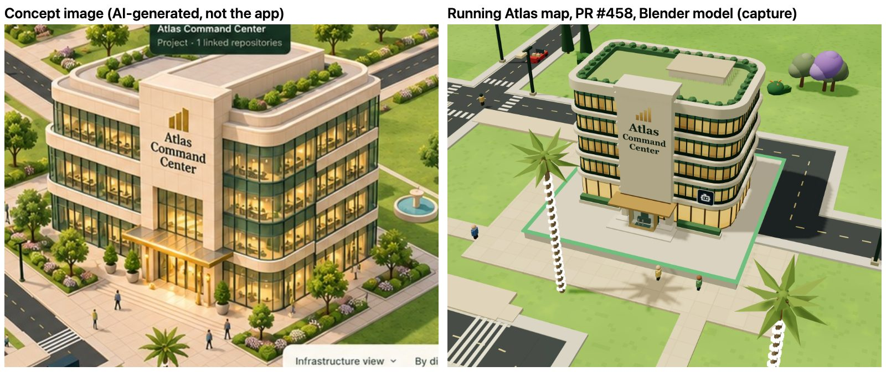

# Atlas Command Center: cream stone, green glass, brass (prototype)

Khaneil, 2026-11-17: start the Atlas design concept with Atlas Command Center only. Cream stone,
forest-green glass and subtle brass; the outside is the lobby and four office floors you walk
through inside. Parcel, roads, selection, building entry, floor navigation, agents and telemetry
unchanged. The concept images were references, not geometry: everything here is the running app.

Second pass, same day: Khaneil said the first version "look nothing like the image". The second
pass painted the concept's stone grid and windows onto the old rounded block as a texture.

Third pass, same day: the concept image reached the repo (`concept/`) and Blender was installed on
Khaneil's Mac, so the building is now a model built in Blender after the concept, not a painted
block. What it takes from the concept as geometry: continuous glass behind slim dark green
mullions; thick cream stone floor slabs with a dark green sill line, standing proud of the glass;
a glass wing on the right that turns the front corner in a wide curve; the left wing a step back;
the stone entrance bay over the joint, rising above the roof; a gold-lit lobby behind brass
mullions; a stone parapet with hedges and shrubs right round the roof and a low plant room.

Left: the AI-generated concept (not the app). Right: a capture of the running Atlas map.

## How it is built

- **Why Blender.** Atlas's landmarks are generated in code from shared helpers that make rounded
  walls, bands, fins and flat lids. The concept needs a stepped plan with mixed corner radii,
  hundreds of mullions following the curves, slabs and sills offset from the glass and roof
  planting: possible in code, but it would mean new hand-written geometry. A script that builds
  the model in Blender keeps it reproducible and editable, and Atlas already loads GLBs (the
  office furniture, with drei's `useGLTF`, no Draco or Meshopt so the CSP stays strict).
- `assets/command-center/build_command_center.py`: the source. It rebuilds
  `assets/command-center/command-center.blend` (editable) and exports
  `public/models/map/command-center.glb` (about 300 KB, 5.3k triangles, eight meshes, no
  textures). Run: `/Applications/Blender.app/Contents/MacOS/Blender --background --factory-startup
  --python assets/command-center/build_command_center.py`.
- One mesh per material (`cc_glass`, `cc_lobby`, `cc_stone`, `cc_roof`, `cc_frame`, `cc_brass`,
  `cc_hedge`, `cc_lawn`). `AtlasHq.tsx` draws each with the map's own material for that name, so
  focus dimming and night lighting work as on every other building; until the model arrives (or if
  it fails) a plain stone block of the same size stands in and stays clickable.
- `src/views/map3d/commandCenterPlan.ts`: the same numbers for everything the map places around
  the model (footprint, storeys, bay, doors, canopy, planters, nameplate). `atlasHq.test.ts` reads
  the GLB and checks its footprint, storey heights, roof and bay against the plan, its triangle
  budget, that it has no textures or decoders, and that the Blender source sits next to it.
- `src/views/map3d/commandCenterTextures.ts`: what is seen through the glass (green sky
  reflection over warm offices, a tile of 8 panes by 4 storeys) and the gold lobby, plus the
  nameplate. The procedural `commandCenterGeometry.ts` is gone.
- `src/views/map3d/atlasHqPalette.ts`: the shared colours; the interior shell
  (`src/views/office/AtlasHqShell.tsx`) reads the same palette and the block's proportions.

## What changed on purpose

- The building is a five-storey block, lower than the old tower. Three height guards that said
  "Atlas HQ is the tallest" now compare Benjaire HQ and Commerce with Atlas's height share instead,
  and the stadium check leaves Atlas out. The other buildings' heights do not change.
- Inside: green glass on every office floor, warm glass in the lobby, cream stone piers and
  mullions, a slim brass canopy, a flat top floor. The Floor 3 podium terrace is gone.

## Validation

- Map performance, unchanged budget (`PERF_BUDGET=1 npm run measure:perf`), passed: desktop day
  734 draw calls of 800, 887,228 triangles of 1.2M, 73 programs of 80, 6.6 MB geometry, one
  context; night 755 draws, 891,735 triangles; iPhone day 731 draws, 877,272 triangles. After
  leaving and re-entering the map, 8 more buffers stay alive (the loaded model, which drei keeps
  cached so it is not fetched again); textures and programs return to where they were.
- The model: 5,336 triangles (the procedural block allowed 12,000), eight meshes, about 300 KB.
- `npm run lint`, `npm run typecheck` and `npm test` (1,901 of 1,901) pass.
- Screenshots: `npm run visual -- atlas-hq atlas-hq-interior` with `SHOT_DIR`. Before is `main`
  at 62eba93; the second pass (painted block) is kept in [second-pass/](second-pass/) for comparison.

| | Before | After |
| --- | --- | --- |
| Concept angle | (concept image above) | [day](after/concept-day.jpg), [night](after/concept-night.jpg) |
| Map as it opens | [before](before/map-day.jpg) | [after](after/map-day.jpg) |
| Exterior | [before](before/front-day.jpg) | [after](after/front-day.jpg) |
| Closer exterior | [before](before/close-day.jpg) | [after](after/close-day.jpg) |
| Night | [before](before/front-night.jpg) | [after](after/front-night.jpg) |
| Interior, all floors | [before](before/all-day.jpg) | [after](after/all-day.jpg) |
| Interior, Floor 4 | [before](before/agents-day.jpg) | [after](after/agents-day.jpg) |
| Selected | [before](before/selected.jpg) | [after](after/selected.jpg) |
| iPhone map | [before](before/phone-map.jpg) | [after](after/phone-map.jpg) |
| iPhone exterior | [before](before/phone.jpg) | [after](after/phone.jpg) |
| iPhone interior | [before](before/phone-all.jpg) | [after](after/phone-all.jpg) |

Rollback: revert this pull request.
