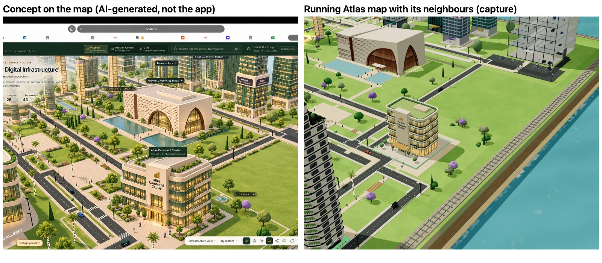

# Atlas Command Center: cream stone, green glass, brass (prototype)

Khaneil, 2026-11-17: start the Atlas design concept with Atlas Command Center only. Cream stone,
forest-green glass and subtle brass; the outside is the lobby and four office floors you walk
through inside. Parcel, roads, selection, building entry, floor navigation, agents and telemetry
unchanged. The concept images were references, not geometry: everything here is the running app.

Second pass, same day: Khaneil said the first version "look nothing like the image". The second
pass painted the concept's stone grid and windows onto the old rounded block as a texture.

Third pass, same day: the concept image reached the repo (`concept/`) and Blender was installed on
Khaneil's Mac, so the building is now a model built in Blender after the concept, not a painted
block. What it takes from the concept as geometry: continuous glass behind slim dark green
mullions; thick cream stone floor slabs with a dark green sill line, standing proud of the glass;
a glass wing on the right that turns the front corner in a wide curve; the left wing a step back;
the stone entrance bay over the joint, rising above the roof; a gold-lit lobby behind brass
mullions; a stone parapet with hedges and shrubs right round the roof and a low plant room.

Fourth pass, same day: Khaneil asked for the concept's size ("align with the sizing on the growth
studio and vendor supplier building", then "expand building dimension to match the images
design"), the concept's grounds, stairs and window lighting, and the Blender file always kept in
step. The headquarters grows from 2.55 to 4 map units (`ATLAS_HQ_SIZE` in `mapLayout.ts`) inside
Command Center's own empty 10 by 10 parcel, about its centre line toward the south, so its north
street stays in line with Commerce's and no other district, building or street moves (3.8 to 4.1
is the range where every neighbouring plan, the Marketplace, Galleria, Commons and rail loop,
still lays out unchanged). The plan is wider and lower (storeys at 10 interior units per plan
unit), so on the campus the roof stands about 3.3 map units up, with the Studio's 3.1 to 3.8.
The windows show lit offices with people at desks and screens; the front has broad stone stairs
under a deep brass canopy on brass columns, stone-kerbed flower beds, potted trees by the door and
round trees at the corners (`ccEntrance`, `ccGrounds`).

Left: the AI-generated concept (not the app). Right: a capture of the running Atlas map.

## How it is built

- **Why Blender.** Atlas's landmarks are generated in code from shared helpers that make rounded
  walls, bands, fins and flat lids. The concept needs a stepped plan with mixed corner radii,
  hundreds of mullions following the curves, slabs and sills offset from the glass and roof
  planting: possible in code, but it would mean new hand-written geometry. A script that builds
  the model in Blender keeps it reproducible and editable, and Atlas already loads GLBs (the
  office furniture, with drei's `useGLTF`, no Draco or Meshopt so the CSP stays strict).
- `assets/command-center/build_command_center.py`: the source. It rebuilds
  `assets/command-center/command-center.blend` (editable) and exports
  `public/models/map/command-center.glb` (about 300 KB, 5.3k triangles, eight meshes, no
  textures). Run: `/Applications/Blender.app/Contents/MacOS/Blender --background --factory-startup
  --python assets/command-center/build_command_center.py`.
- One mesh per material (`cc_glass`, `cc_lobby`, `cc_stone`, `cc_roof`, `cc_frame`, `cc_brass`,
  `cc_hedge`, `cc_lawn`). `AtlasHq.tsx` draws each with the map's own material for that name, so
  focus dimming and night lighting work as on every other building; until the model arrives (or if
  it fails) a plain stone block of the same size stands in and stays clickable.
- `src/views/map3d/commandCenterPlan.ts`: the same numbers for everything the map places around
  the model (footprint, storeys, bay, doors, canopy, planters, nameplate). `atlasHq.test.ts` reads
  the GLB and checks its footprint, storey heights, roof and bay against the plan, its triangle
  budget, that it has no textures or decoders, and that the Blender source sits next to it.
- `src/views/map3d/commandCenterTextures.ts`: what is seen through the glass (green sky
  reflection over warm offices, a tile of 8 panes by 4 storeys) and the gold lobby, plus the
  nameplate. The procedural `commandCenterGeometry.ts` is gone.
- `src/views/map3d/atlasHqPalette.ts`: the shared colours; the interior shell
  (`src/views/office/AtlasHqShell.tsx`) reads the same palette and the block's proportions.

## Baked lighting and real materials

Added 2026-11-17 to bring the map building closer to the concept close-up. All of it happens in
`build_command_center.py` with Cycles, so `npm run model:command-center` remakes it:

- **Soft baked lighting.** Ambient occlusion (reach 0.12 map units, a little over three slab depths)
  is baked into the colour of every solid part: a shadow under each stone ledge, darker joints
  where the slabs meet the glass and the bay, darker corners on the roof and plant room. A ground
  plane is present for the bake only, so the base darkens where it meets the plaza. Glass and
  lobby keep the app's window texture and take the occlusion as an `aoMap` on a second UV set.
- **Window glow on the stone.** A second bake lights the stone and the green sills with nothing
  but the warm offices and the gold lobby. The map shows it as an emissive map: soft by day
  (0.12), full at night (1.0), so the slabs and the entrance bay catch the light from the floors.
- **Real stone.** The slabs, parapet, bay and plant room use Poly Haven's *Marble 01* (a cream
  limestone cladding), box-mapped at its real 1.5 m tile, contrast eased to 75% and graded to the
  palette's cream so the veining stays subtle at map scale.
- **Brushed brass.** Poly Haven has no brushed brass (its metals are rusty or dark plate), so the
  brass is made in the script: fine vertical streaks in its colour and roughness.
- **Green glass** stays reflective (roughness 0.3, metalness 0.1) and keeps the lit offices.

Textures are baked on a UV set laid by the script (slab rings cut into quarters so they pack
tightly) and ship inside the GLB as JPEG: stone 1024 px, frame, roof and glass 512 px, the rest
256 px. They are not WebP: GLTFLoader decodes WebP through a `blob:` URL, which the hosted CSP
(`img-src 'self' data:`, `connect-src 'self'`) blocks. `src/views/map3d/glbTextures.ts` decodes
the GLB's JPEG and PNG textures straight from its bytes instead, so the CSP is unchanged.
`AtlasHq.tsx` puts the GLB's maps on the map's own materials by part name.

Credits: *Marble 01* by Rob Tuytel, [Poly Haven](https://polyhaven.com/a/marble_01), CC0. The
1k diffuse map is kept in `assets/command-center/textures/` as the bake's source.

## Changing the design

1. Edit `assets/command-center/build_command_center.py` (the source; hand edits in the .blend are
   overwritten by the next build). Footprint, storey or bay changes also go in `commandCenterPlan.ts`.
2. Run `npm run model:command-center`. It rebuilds the .blend and the GLB together and writes
   `assets/command-center/build.json`, a fingerprint of the script, the .blend and the GLB.
3. Commit all four files. `npm test` fails if the script, .blend or GLB changed without a rebuild,
   or if the GLB no longer matches the plan, so the Blender file always matches what the map shows.
   If the .blend is open in Blender, File > Revert shows the rebuilt one.

## What changed on purpose

- The building is a five-storey block, lower than the old tower. Three height guards that said
  "Atlas HQ is the tallest" now compare Benjaire HQ and Commerce with Atlas's height share instead,
  and the stadium check leaves Atlas out. The other buildings' heights do not change.
- Inside: green glass on every office floor, warm glass in the lobby, cream stone piers and
  mullions, a slim brass canopy, a flat top floor. The Floor 3 podium terrace is gone.

## Validation

- Map performance, unchanged budget (`PERF_BUDGET=1 npm run measure:perf`), passed: desktop day
  734 draw calls of 800, 881,368 triangles of 1.2M, 73 programs of 80, 6.7 MB geometry, one
  context; night 760 draws, 894,154 triangles; iPhone day 733 draws, 875,740 triangles. After
  leaving and re-entering the map, 8 more buffers stay alive (the loaded model, which drei keeps
  cached so it is not fetched again); textures and programs return to where they were.
- The model: 6,300 triangles (the procedural block allowed 12,000), eight meshes, about 390 KB
  before the bake.
- Baked lighting and materials (same budget, passed): desktop day 734 draws of 800, 881,368
  triangles, 75 programs, 105 textures, 6.7 MB geometry; night 752 draws, 882,068 triangles,
  80 programs (the budget's limit; 73 before, since the stone and sills now carry an emissive map);
  iPhone day 733 draws, 875,740 triangles. The GLB is 1.19 MB with eleven JPEG textures
  (about 0.8 MB of it); the draw and triangle counts do not change.
- `npm run lint`, `npm run typecheck` and `npm test` pass (1,902 tests; the 300-repository timing
  test passes on its own and is load-sensitive in the full parallel run).
- Map layout guards updated on purpose: Command Center's headquarters is `ATLAS_HQ_SIZE` (4) instead
  of the shared 2.55, and the test checks it stays inside its own parcel; every other parcel,
  headquarters size and street-reserve check is unchanged.
- Screenshots: `npm run visual -- atlas-hq atlas-hq-interior` with `SHOT_DIR`. Before is `main`
  at 62eba93; the second pass (painted block) is kept in [second-pass/](second-pass/) for comparison.

| | Before | After |
| --- | --- | --- |
| Concept angle | (concept image above) | [day](after/concept-day.jpg), [night](after/concept-night.jpg) |
| Map as it opens | [before](before/map-day.jpg) | [after](after/map-day.jpg) |
| Exterior | [before](before/front-day.jpg) | [after](after/front-day.jpg) |
| Closer exterior | [before](before/close-day.jpg) | [after](after/close-day.jpg) |
| Night | [before](before/front-night.jpg) | [after](after/front-night.jpg) |
| Interior, all floors | [before](before/all-day.jpg) | [after](after/all-day.jpg) |
| Interior, Floor 4 | [before](before/agents-day.jpg) | [after](after/agents-day.jpg) |
| Selected | [before](before/selected.jpg) | [after](after/selected.jpg) |
| iPhone map | [before](before/phone-map.jpg) | [after](after/phone-map.jpg) |
| iPhone exterior | [before](before/phone.jpg) | [after](after/phone.jpg) |
| iPhone interior | [before](before/phone-all.jpg) | [after](after/phone-all.jpg) |

Rollback: revert this pull request.
