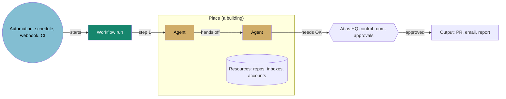

# Atlas as a personal command center

KC, 2026-11-03: change the infrastructure of Atlas so buildings are just locations where agents
work, and the whole app becomes a personal command center for running life and business with
agents, where workflows and automations can be seen moving through Atlas city.

**Status: design only, awaiting KC's decisions.** Nothing in the app, the catalog or any data
changes until KC approves this page. Each phase below is its own small pull request.

## The idea in one paragraph

Today a building *is* a project: every repository gets a headquarters, and every agent and
automation that project declares lives inside it. In the new model a building is a **place**, a
location with a purpose (Sales Office, Engineering Studio, Treasury, Home Office). **Agents** are
workers who have a job at a place. **Workflows** are the work itself: a chain of steps that
travels between places, carried out by agents and automations. **Automations** are the city's
utilities: the clocks, mail routes and power lines that start workflows on a schedule or on an
event. The repositories, inboxes and accounts that agents touch become **resources** kept inside
places, not buildings of their own. Atlas HQ becomes the **control room**: one screen for what
needs KC today, across life and business.

## What changes, and what stays

| Today | Command center |
|---|---|
| One building per catalog project (`District.project`, `src/views/mapLayout.ts`) | One building per **place**; a place can host agents from many projects |
| Agents and automations live in their project's HQ (`District.crew`); a few declare a `workplace` in a brand building (`src/catalog/workplaces.ts`) | Every agent has a declared place (the `work` field the Workday tab already shows) |
| Repository = building | Repository = a resource listed inside the place whose agents use it |
| Connections are lines between buildings from manifests (`src/lib/connections.ts`), shown by lens (`src/lib/lenses.ts`) | Workflows are named routes through places, and a run is drawn travelling the route |
| Grouping: district, status, tag | Grouping: **domain** (Business, Engineering, Career, Life), with today's groupings kept as lenses |
| Mission Control is a separate view | The control room lives in Atlas HQ and docks beside the map |

What does **not** change:

- **Honest status.** A building lights, a worker glows and a courier moves only when a real run is
  observed (GitHub Actions, the Atlas run log, the live feed, n8n executions). The rules in
  `src/views/office/activity.ts` and the agent workday rule "simulated is not verified" carry
  over unchanged.
- **One source of truth.** Places and workflows are declared in manifests next to the agents, and
  every inferred value says it is inferred (`Decided<T>`, as districts and jobs do today).
- **No new running cost.** Drawing workflows is plain code. No model calls, no agent loops, no
  extra polling (KC's token rule, Oct 31).
- **Guarded actions.** Anything that writes (merge, close, send, spend) still goes through the
  Mac app's approval step with Touch ID, never from the web page.
- **Map budget.** The map is near its geometry budget, so places reuse the existing buildings and
  workflow runs reuse the crowd and car instancing. No per-item meshes or labels.

## The core model



### Places

A place is a building with a purpose, in a domain. It is what you click on the map.

```yaml
# catalog/places/sales-office.yaml (proposed)
place:
  id: sales-office
  name: Sales Office
  domain: business          # business | engineering | career | life
  building: benjaire-hq     # which existing building on the map it uses
  purpose: Answer inquiries, follow up leads, take payments
  resources:
    - repo: khaneilcampbell/benjaire.com
    - inbox: Benjaire inquiries (n8n data table flow_inquiries)
```

- Every existing building becomes a place first, with no visual change (phase 1). The project
  HQs become places named for what happens there, for example Benjaire HQ becomes the Sales
  Office, Atlas HQ becomes the Control Room.
- Life places (Treasury, Home Office, Health) follow the Oct 30 life districts design: a separate
  Personal island, data local to the Mac and encrypted, never in this public repository, never on
  the web page.

### Agents

Agents keep their manifests. The `job:` block planned in the agent workdays phase 2
(`docs/agent-workdays.md`) gains one rule: `job.place` names a place id, and it replaces both the
project HQ default and the separate `workplace` field. An agent can work in a place that belongs
to a different project, which is exactly what "buildings are just locations" means.

### Workflows

A workflow is a named chain of steps that crosses places. It is declared once and shown in three
places: the map, the control room, and the inspector of every agent it uses.

```yaml
# catalog/workflows/inquiry-to-reply.yaml (proposed)
workflow:
  id: inquiry-to-reply
  name: Website inquiry to reply
  domain: business
  trigger: {automation: benjaire-site-worker, event: form submitted}
  steps:
    - {by: benjaire-site-worker, at: website, does: Validate form and forward}
    - {by: benjaire-flow-intake, at: sales-office, does: Classify with Claude Haiku and save}
    - {by: inquiry-reply-drafter, at: sales-office, does: Draft a reply, approval: send}
    - {by: kc, at: control-room, does: Approve and send}
  outputs: [Reply email, Row in flow_inquiries]
  observe: {source: n8n, workflow: 1-intake}
```

- Steps point at existing catalog ids, so a test can check that every agent, automation and place
  in a workflow exists.
- `observe` says where real runs come from. A workflow with no observable source is drawn as a
  plan (dotted route), never as a run.
- A step with `approval:` stops at the control room until KC approves in the Mac app.

### Automations

Automations (CI, schedules, webhooks, n8n flows without a model) are the utilities that start and
connect workflows. On the map they are the quiet infrastructure: a clock on the building for a
schedule, a mail route for a webhook, the existing kiosks for outside services
(`src/views/toolWorkflowLayout.ts`). They are not workers and do not walk.

### Resources

Repositories, inboxes, data tables and accounts are listed in the place's inspector with their
live status (CI health, last commit, open pull requests), the same data the repo buildings show
today. Repositories with no manifest stay visible in a Records lot until they are assigned.

## How it looks in Atlas city

- **At rest.** Buildings are places, labelled by purpose. Workers walk to their place in the
  morning and home at night, as they do now. Workflow routes are hidden.
- **A run starts.** A courier leaves the trigger's place and travels the streets to each step's
  place, pausing inside while that step runs. It reuses the crowd mesh (walking) or the car
  instancing (between domains), so it adds no draw calls.
- **Waiting for KC.** A courier that reaches an approval step waits at the Control Room gate and the
  control room shows a card. Proposals expire after 48 hours, as in the workflow agents design.
- **Failure.** The courier stops where the step failed, the place glows amber, and the control
  room links to the failing run.
- **Workflows lens.** A new map view draws every declared route, solid when a run was observed in
  the last 14 days, dotted when it is only a plan. Selecting a workflow replays its last real run.
- **Control room.** Atlas HQ's panel (and the docked panel on desktop) has four lists: Waiting on
  you (approvals), Failed or silent (alerts), Due today (scheduled runs and life reminders), and
  Spend this month against caps. On iPhone it is the first screen.

## How it relates to the existing designs

| Design | How it fits |
|---|---|
| Agent workdays (`docs/agent-workdays.md`, merged #195 #196) | The base. Homes, shifts and walks stay; `job.place` becomes the work location. |
| Guarded workflow agents and Approvals inbox (Oct 31) | Its five agents become the first declared workflows; the Approvals inbox is the Control Room gate. |
| Agent Manager, 7 gates (Oct 31) | Gate status shows on each worker; only production agents can be a step in a live workflow. |
| Automation to agent review (Oct 31) | Its 33 rows sort into workflows (multi-step), automations (keep as code) and retire. |
| Token minimization (Oct 31) | Respected: drawing and status are plain code; models run only inside steps that already use them. |
| Life districts (Oct 30) | The Life domain and the Personal island; same local-only data rules. |
| Districts and lenses (#82) | Today's five districts become domains (AI Operations and AI Engineering merge into Engineering); district, status and tag stay as lenses. |
| Business plan (Nov 2) | The reframe is the product: "see every agent and workflow you run, in one city". Functional place names also remove most of the real-brand cleanup the plan flagged. |

## Phased migration, keeping the app working

Every phase is one small pull request, ships through the normal updater, and can be reverted on
its own. Nothing disappears from the map until its replacement is visible.

| Phase | What ships | What KC sees | Done when |
|---|---|---|---|
| 0. This design | `docs/command-center.md` | Nothing in the app | KC answers the decisions below |
| 1. Places, data only | `src/catalog/places.ts`, `catalog/places/*.yaml`, every existing building mapped to a place, every agent resolved to one, tests | Inspector shows "Place" on buildings and agents | Every agent has a place, map unchanged |
| 2. Workflows, data and list | Workflow manifest, parser, schema, three seeded workflows (inquiry to reply, Merge Flow, Opportunity Scout report), a Workflows tab in Mission Control with steps and last observed run | A list of workflows with honest run status | Every step resolves to a catalog id |
| 3. Workflows on the map | Workflows lens, routes on the street graph, couriers for observed runs, replay last run | Runs travelling the city | `measure:perf` within budget on Mac and iPhone |
| 4. Control room | Atlas HQ panel and docked desktop panel: waiting on you, failed or silent, due today, spend | One place to start the day | Approvals, alerts and spend all appear there |
| 5. Places replace repo buildings | Map grouped by domain; repositories listed inside places; "By repository" kept as a lens for a month, then removed if unused | Buildings named for what happens there | Every repository reachable from a place |
| 6. Life domain | Personal island from the life districts design, local-only data | Life places beside business | KC's chosen life places live, nothing personal on the web |

Phases 1 and 2 change no visuals, so they are low risk. Phase 3 is where the map budget matters.
Phase 5 is the only phase that removes something, and it waits until 3 and 4 have been in use.

## Risks

- **Confusing a plan with a run.** Mitigated by the dotted-versus-solid rule and the same
  observed-runs-only rule the buildings use today.
- **Map budget.** At 94% of the geometry budget (Nov 1 grade). Couriers reuse instancing; the
  Workflows lens draws routes as one line batch; phase 3 includes before and after `measure:perf`.
- **Personal data in a public repository.** Life places and their resources are declared locally
  (Touch ID vault), never in `catalog/`. A test fails if a `life` place appears in the repository.
- **Migration churn.** Phase 1 keeps building ids, storage keys (`mapGroupBy2`, `mapLens`) and
  visual baselines as they are, so screenshots only change when the map actually changes.
- **Too many open designs.** This page overlaps four designs still awaiting OKs. Approving it would
  settle the order: workdays phase 2, then this page's phases 1 to 4, then workflow agents inside
  that frame.

## Decisions for KC

1. **What happens to repository buildings.** Recommended: repositories become resources inside
   places in phase 5, with "By repository" kept as a lens for a month. Alternative: keep a building
   per repository and add places beside them (more buildings, less clarity).
2. **Life now or later.** Recommended: business and engineering first (phases 1 to 5), life
   domain after, local-only. Alternative: start the Personal island in parallel.
3. **How a workflow run looks.** Recommended: a courier travelling the streets, routes hidden
   unless the Workflows lens is on. Alternative: glowing lines between places.
4. **First screen.** Recommended: the map with the control room docked beside it on desktop, the
   control room first on iPhone. Alternative: control room first everywhere.
5. **Place names.** Recommended: functional names (Sales Office, Treasury, Engineering Studio),
   which also helps the business plan; brand buildings stay as the look of a place, not its name.
   Alternative: keep brand and project names.
