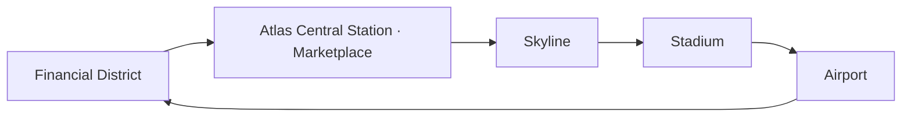

# Compact city and perimeter railway · PR #256

The active city has a square outer land envelope, with its original core canals preserved. Atlas Hills is absent from the map; catalog agents and history remain. The highway is removed. Canva freight uses a local service street to the airport, and existing local traffic remains.

## Route

One train uses a closed rounded-square route. All five stops share placement data, 15-second dwells, door timing, selection panels, platform geometry and passenger paths. Ten unnamed visitors use the actual station walks; these are visual simulation, not registered-agent execution. Traffic off, Battery saver, reduced motion, an unfocused window and a hidden map pause movement.

## Structural repairs

- Replaced the branch/shuttle render path with one loop and five supported platforms. Platform-side guardrails open only at boarding areas; outer rails remain protected.
- Moved the airport north toward the Financial District without touching runway/gate geometry. Public station access skirts the airside reservation instead of crossing it.
- Shared local freight data drives both the service street and truck. Office towers use a Financial District-relative minimum height; bespoke HQ architecture and interior floor assignments remain unchanged.

## Evidence

[Before desktop](before-1512-day.png) · [Before phone](before-390-day.png)

[Desktop day](after-1512-day.png) · [Desktop night](after-1512-night.png) · [Phone day](after-390-day.png) · [Phone night](after-390-night.png)

Station views: [Financial](financial-day.png), [Marketplace](atlas-day.png), [Skyline](skyline-day.png), [Stadium](stadium-day.png), [Airport](airport-day.png).

## Checks and limits

990 unit tests pass, two existing tests remain skipped. Type checks, lint and production build pass. Focused route checks cover all grouping layouts, loop continuity, building/runway clearance, passenger transition timing, station reachability and lane continuity. The large synthetic city check passes with one test worker; parallel software-WebGL rendering can exceed its unchanged timing budget.

Browser screenshots use fixture GitHub data, not live operational evidence. No visual baseline was replaced. The station lifts remain schematic geometry rather than an independently simulated accessible lift. Legacy shuttle planning helpers remain for compatibility tests; only the loop is rendered. No services, agents or paid calls are activated.

## Rollback

Revert PR #256 before a future release. Nothing is merged or deployed by this branch. No repositories or agent history are deleted.
