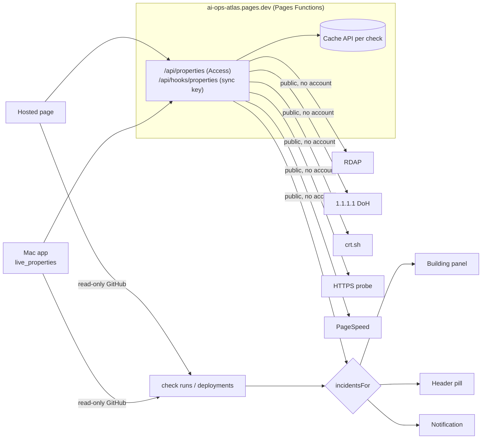

# Website property dashboards

KC, 2026-11-03 (senior engineer prompt, item 3, Domain and Website Operations): turn the
benjaire.com and khaneilcampbell.com buildings into live property dashboards with domain
expiration, DNS, SSL, uptime, deployments, Cloudflare events, performance and traffic where data
is available. A failed deployment surfaces as an actionable incident on the building.

**Status:** built in this pull request. Everything that needs no new credential is live.
Cloudflare traffic and change events read KC's read-only token once it is saved on the site
(KC created it on Nov 3). Uptime Kuma history shows "Not connected" until KC supplies its address
(see [What KC supplies](#what-kc-supplies)).

## Where it shows

| Place | What KC sees |
|---|---|
| Benjaire HQ and Portfolio Site panels (map and lists) | A "Live site" section at the top: open incidents with links to act, then one tile per signal |
| Header | A red pill ("benjaire.com: production deploy failed", or "2 website incidents") while any incident is open; clicking it opens that building |
| System notifications | One notification per new critical incident, when "Notify me on this device" is on (the same switch as agent alerts) |

This follows the command center design (`docs/command-center.md`, draft #210): a website is a
**resource** of the place that runs it (Benjaire HQ becomes the Sales Office), and its incidents
are exactly what the Control Room's "Failed or silent" list will gather in phase 4. Until then,
they live on the building and the header pill.

## Signals and sources

| Tile | Source | Credential | Refresh |
|---|---|---|---|
| Deploys | GitHub. benjaire.com: the "Workers Builds: benjaire-com" check run on the newest 3 commits of `main`. khaneilcampbell.com: `github-pages` deployments and their newest status | None new (Atlas's existing read-only GitHub access) | Every 5 min, and 45 s after the live feed sees a push or workflow run in the site's repository |
| Reachable now | One HTTPS request to the site from Cloudflare's network: status, time, HSTS, served by Cloudflare | None | Cached 1 min on the site |
| SSL certificate | Certificate Transparency logs (crt.sh): newest unexpired certificate covering the apex, its issuer and end date | None | Cached 6 h |
| Domain | RDAP (rdap.org, the registry's own data): registrar, registered, expiry, status, nameservers, DNSSEC | None | Cached 12 h |
| DNS | Cloudflare DNS over HTTPS (1.1.1.1): A, AAAA, NS, MX, CAA, www, DNSSEC validation | None | Cached 10 min |
| Mobile speed | Google PageSpeed Insights (mobile): Lighthouse score, LCP, CLS, TBT, and real-user field data when the site has enough traffic | None; optional `PAGESPEED_API_KEY` raises the quota | Cached 6 h |
| Traffic, 24 h | Cloudflare GraphQL analytics (`httpRequests1hGroups`, last 24 full hours): requests, page views, threats | `CLOUDFLARE_API_TOKEN` | Cached 10 min |
| Cloudflare events | Cloudflare account audit log, last 7 days, entries that mention the zone, the domain or the site's Worker (DNS, rules, certificates, Worker deploys) | `CLOUDFLARE_API_TOKEN` | Cached 10 min |
| Uptime | Uptime Kuma status page: uptime % and the last up/down change | `UPTIME_KUMA_URL` and a status page | Not wired yet |

Honesty rules, the same as agent alerts:

- A tile always says what its source said and when (hover for the source and age).
- A source that can't answer shows **Unknown** with the reason, never healthy and never an
  incident. If DNS also failed, an unreachable site is treated as a checker problem, not an outage.
- "Reachable now" is one request, not uptime. Uptime percentages only come from Uptime Kuma.
- The SSL tile reads the public certificate logs, which show what was issued, not the exact
  certificate a visitor is served. With Cloudflare in front, that is Cloudflare's edge certificate,
  which it renews about 30 days ahead, so the two agree in practice.

## How the data flows

- `src/properties/registry.ts`: the two websites, their building, repository, deploy source and
  deploy console. The server checks only these domains.
- `server/properties.ts`: the checks, cached per check on the site. PageSpeed often takes 20 s or
  more, so the site waits up to 12 s, answers "still testing" if needed, and lets the run finish
  into the cache (`waitUntil`). The Mac's HTTP client gives up at 20 s.
- `src-tauri/src/live.rs` `live_properties`: the Mac reads the same answer with its website sync
  key, like the inquiry inbox. No new secret on the Mac.
- `src/properties/deploys.ts`: GitHub requests go through the existing transport (Keychain token
  on the Mac, server token on the web, ETag caching so unchanged answers are free). The web proxy's
  allowlist gains `commits/{sha}/check-runs`, `deployments` and `deployments/{id}/statuses`.
- `src/properties/incidents.ts`: turns observed data into incidents.
- `src/properties/state.ts`: one store and poller, only while the window is visible. No model
  calls and no agent loop (KC's Oct 31 token rule).

## Incidents

| Incident | When | Severity | Actions on the card |
|---|---|---|---|
| Production deploy failed | The newest finished production deploy failed. A later success closes it | Critical | Build log, Cloudflare builds or GitHub Pages deployments, **Fix with Claude** |
| Deploy hasn't finished | A deploy has been queued or running for over 30 min | Warning | Build log, deploy console |
| Site is returning errors / didn't answer | The probe got HTTP 5xx, or no answer while DNS works | Critical | Open the site, deploy console, Fix with Claude |
| Domain has no address records | No A or AAAA on the apex | Critical | Cloudflare DNS records |
| Certificate expires in N days | Under 14 days (critical under 3) | Warning / Critical | Cloudflare edge certificates, certificate log |
| Domain expires in N days | Under 30 days (critical under 7) | Warning / Critical | Registrar |
| Mobile speed score N | PageSpeed mobile score under 50 | Warning | PageSpeed report |

Each incident has a key for this occurrence (for example the failed build's id), so **Dismiss**
hides it on this device until the next occurrence. **Fix with Claude** is the existing link
(`ops/fix-with-claude/`): it opens a prefilled `claude-fix` issue; nothing is sent until
KC presses Create.

## What KC supplies

Nothing is needed for what shipped here. For the remaining tiles:

1. **Cloudflare API token** (traffic and events). Created Nov 3 as "Read analytics and logs" at
   https://dash.cloudflare.com/profile/api-tokens. **Read only** permissions it needs: Zone → Zone →
   Read (find the zone by name), Zone → Analytics → Read, Account → Account Settings → Read (the
   audit log). Zone Logs, Account Analytics and Workers Observability read are harmless extras;
   resources: the accounts that hold benjaire.com (Workers account "benjaireco") and
   khaneilcampbell.com (registered on Cloudflare, which runs its DNS; GitHub Pages serves it). Saved as the encrypted Pages secret `CLOUDFLARE_API_TOKEN` at
   https://dash.cloudflare.com/2ff911bc5c9acdcb7f6088b9a25f002f/pages/view/ai-ops-atlas/settings/production.
   Never in the repository, never on the web page.
2. **Uptime Kuma**: the address of the self-hosted Kuma, a monitor for each site, and a public
   status page that includes them. Saved as `UPTIME_KUMA_URL` (and the status page slug) in the
   same Pages settings. Kuma's status page API needs no key.
3. Optional: a Google API key restricted to the PageSpeed Insights API, as `PAGESPEED_API_KEY`,
   if the free anonymous quota runs out.
4. Optional: in the "KC Atlas Live" GitHub App, subscribe to **Check run** events so a Workers
   Builds failure reaches Atlas within seconds instead of on the next 5-minute check.

## Next steps

1. Confirm the Cloudflare tiles on the deployed site once the token is saved. Both domains are
   zones in KC's account. khaneilcampbell.com is served by GitHub Pages: if its records are DNS
   only (grey cloud), Cloudflare sees no requests and the Traffic tile says "Not proxied", not zero.
   A domain outside the account shows "not in your Cloudflare account".
2. Wire Uptime Kuma (`/api/status-page/{slug}` and `/api/status-page/heartbeat/{slug}`), and
   let a Kuma "down" open the site-down incident instead of the single probe.
3. Map: tint the building amber or red while it has an open incident (command center phase 3
   uses the same signal for "the place glows amber").
4. Command center phase 1: declare each website as a `resource` of its place and move the
   registry into `catalog/places/*.yaml`.
