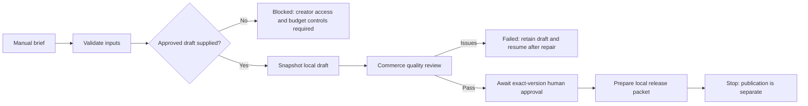

# Benjaire manual production team

This is a **local supplied-draft handoff**, not autonomous product generation. It uses existing registered roles and the existing Commerce pre-upload validator. No n8n engine, provider, publishing module, database, customer messaging, feed write, or paid call is invoked.



| Existing agent | Owning project | Stage ownership | Actual execution in this pass | Readiness |
| --- | --- | --- | --- | --- |
| `atlas-production-coordinator` | `ai-ops-atlas` | Brief, checkpoints, blockers, approval readiness, local release preparation | Deterministic local Python runner; future manually dispatched GitHub fixture | Implemented and tested; no schedule |
| `canva-mockups` | `commerce-pipeline` | Product visuals/draft handoff | **Not invoked.** Its documented creator requires Anthropic and Canva. Supplied assets are copied, not generated | External creation blocked; handoff tested |
| `commerce-tests` | `commerce-pipeline` | Quality review | Existing `pre_upload_validator.validate`, called locally | Metadata and JPEG-presence checks only |

These are stage owners, not fabricated agent executions. Existing workplace assignments, ownership, repositories, history, and Commerce execution sources are preserved. Coordinator stays on Atlas HQ Floor 3. No creator or QA run is fabricated in the feed.

## Dependencies and inspected evidence

- Commerce PR #26 adds safe non-text input handling and explicit local asset-root parameters to the existing validator. This runner/workflow pins its inspected commit `230605fdbde89585a96f35ded61cc17562f39135`. That dependency is merged; update the pin through a reviewed PR when needed.
- Atlas PR #234 (Reliability Reviewer) and #237 (B4 triage) were open at inspection. Their runners are not duplicated or activated here.
- `scripts/listing_generator.py`, `canva_image_generator.py` and `canva_product_creator.py` require paid/provider access. They are never imported. Paid calls remain disabled because a hard durable budget ledger is not implemented.
- Existing Skyline n8n export is a synthetic inquiry sandbox, not a product-production engine. Its manual-start/approval separation is reused conceptually. No new n8n export or verified engine run is claimed; a future n8n adapter must invoke this contract through an approved local runner and retain its lock/state boundary.

## Start / resume

Use a trusted checkout of Commerce at the pinned dependency commit. No dependencies need installing for the handoff or validator.

```sh
python3 ops/benjaire-production/team.py \
  --brief ops/benjaire-production/fixtures/brief.json \
  --state-root .local/benjaire-production \
  --commerce-root /absolute/path/to/multi-agent-commerce-pipeline
```

The checked-in brief and eight-pixel solid-color JPEG are explicitly **synthetic fixtures**. They are original test data, not a completed product, professional visual asset, or approved listing. The one verified manual journey stopped at `awaiting approval`, with zero model calls.

For a real handoff, use a local brief with `fixture: false`, `creation_mode: "supplied"`, a stable brief `id`, `product`, `title`, `description`, `tags`, `price`, and up to six relative JPEG paths under the brief's folder. Supplying a brief is not proof of creator generation or publishing approval. Product names are normalized for stable job locking. Private briefs and outputs must remain local and outside Git.

Re-run the same command to resume. Product identity determines a stable job ID; brief content, asset bytes, validator and runner code determine its revision hash. Unchanged prepared files and completed quality results are reused. Each revision retains its own draft and state. Prior valid artifacts are preserved when later stages fail or inputs change. Only the current revision's state/hash is authoritative; older release packets do not authorize a changed draft.

## Approval / release preparation

Inspect the actual local draft, quality result and `report.md`. A quality pass only verifies current metadata rules and JPEG presence. It does not verify image contents, copyright, template delivery, commercial suitability or live links.

Only after human review, explicitly run the same command with:

```sh
--approve-hash <exact-current-review-hash> --reviewer <local-reviewer-name>
```

This is a trusted-local-operator approval record, not an authentication service or shared-host permission boundary. Anyone with write access to the state directory can alter local records; keep it private. The runner creates private files and new directories with owner-only permissions. Changed inputs or tampered prepared files invalidate cached approval. Approval creates a **local release-preparation packet only**, containing `publish_authorized: false`; publishing is not implemented. Do not pass publication credentials to this runner.

## Stop / limits / recovery

- Set `BENJAIRE_PRODUCTION_STOP=true` or create `<state-root>/STOP` before running. Invalid environment values fail closed. The stop file is checked between stages; there is no background process or polling loop.
- Input brief is at most 64 KiB; at most six regular, local JPEG assets of at most 5 MiB each. Unsafe paths/symlinks are rejected. The local ten-second stage budget is cooperative between bounded operations; the hosted fixture has a hard two-minute job limit. There are zero automatic retries.
- A per-product exclusive lock prevents concurrent local runs, including different revisions of the same product. For a stale lock, first verify its recorded process is gone; only then remove that exact lock and resume. Locks are never automatically stolen. Use one private local state root; this is not distributed orchestration.
- State and artifacts persist locally; `job.json`, per-revision state, artifact hashes and bounded history identify the last observed stage. A process crash may leave a `running` record; that is last observed state, not a heartbeat. Manual recovery must verify the process/lock before resuming.
- Hosted manual execution is **fixture-only**, has no approval parameter and no secrets. Its state is ephemeral and is not a durable production queue. It uploads only the synthetic job metadata/summary, not real draft files. No daily trigger is added.
- Existing runner/provider settings are neither read nor changed. Model cost is zero; GitHub runner/artifact usage follows the account plan. No $1 cap is claimed to exist. Any future paid stage must reserve worst-case cost durably, reconcile actual usage, and fail closed when usage/budget is unknown before it can be enabled.

## Atlas visibility and remaining integration

Coordinator's existing Output tab observes `benjaire-production.yml` and links its real GitHub run, summary and artifacts after merge and an explicitly requested manual dispatch. The report includes job, stage, owners, actual execution source, last observation, hashes, blocker and next action. Workflow success means the fixture/report ran; it does **not** mean a product was created, approved or published.

Full structured stage data is in the run artifact/local report; Atlas's current Output UI links those source files rather than ingesting them inline. Local runs are not injected as hosted telemetry. The creator and Commerce QA retain their original sources; no external execution is invented for them. Inline job ingestion and a verified n8n adapter remain follow-ups requiring an approved runtime boundary.

## Validation / rollback

Focused tests cover invalid briefs, path escapes, absent creator assets, duplicate input reuse, exclusive locking, quality failures, exceptions, stop/deadline recovery, restart/resume, changed-input approval invalidation, prepared-file tampering, and no-publication release packets. The actual manual fixture invokes the pinned Commerce validator; the unit tests use controlled adapters to exercise failure paths.

No real product brief was available in this checkout. Creation, hosted workflow execution, n8n execution, publication, schedules and integrations are not activated. Revert this PR to remove the manual runner/fixture workflow and Coordinator source binding; keep local output for audit until explicitly retired.
